# 🥗 TabNutri - Tabela Nutricional Para Fácil Visualização

> Aplicativo que mostra quantos gramas de cada nutriente você consome e permite guardar receitas, mantê-las privadas ou compartilhá-las com outras pessoas.

---

## 📌 1. Sobre o Projeto

O **TabNutri** ajuda quem quer saber o que está comendo sem decifrar tabelas enormes. Você diz o que comeu e quantos **gramas**, e o app devolve calorias, carboidratos, proteínas, gorduras e fibras num **rótulo nutricional** parecido com o das embalagens.

Também dá para **cadastrar receitas**: o app soma os nutrientes dos ingredientes e mostra o valor **por porção**. Cada receita pode ser **privada** (só o dono vê) ou **pública**. Na aba **Explorar**, o usuário encontra receitas de outras pessoas e pode **importá-las**: ele recebe uma cópia privada, que pode editar sem mexer na original.

> O arquivo `prototipo/tabnutri.html` é um protótipo para testar o layout e o fluxo de uso. Nele, o login e as receitas de outras pessoas são **simulados** e nada vai para a internet. O app final será conectado em rede.

**Problemas que o projeto resolve:**
- Tabelas nutricionais são grandes e difíceis de consultar.
- Quem cozinha em casa não sabe quanto de cada nutriente tem na própria receita.
- Boas receitas ficam espalhadas e sem informação nutricional confiável.

**Principais funcionalidades:**
- Cadastro e login de usuários
- Registro do consumo do dia em gramas, com rótulo nutricional
- Cadastro de alimentos
- Receitas com ingredientes, porções e modo de preparo
- Privacidade por receita: privada ou pública
- Explorar receitas públicas e importar para o próprio celular
- Uso offline das receitas salvas, com sincronização quando a internet voltar

---

## 🛠️ 2. Tecnologias, Ferramentas e Infraestrutura

| Camada | Tecnologia |
|---|---|
| Front-end web |     |
| Aplicativo Android |    |
| Dados no celular | -gray?style=for-the-badge) -gray?style=for-the-badge) |
| Back-end |   |
| Banco de dados |   |
| Autenticação |   |
| Cloud |  (EC2 para a API, RDS para o banco, S3 para fotos) |
| Contêineres |  |
| Gerar o APK |  |
| Testes e integração contínua |   |
| Design das telas |  |
| Versionamento |   |

**Privacidade:** cada receita tem o campo `visibilidade` (`privada` ou `pública`) e a API só entrega receitas privadas ao próprio dono. Os dados seguem a LGPD e o usuário pode apagar a conta e as receitas.

---

## 📐 3. Metodologias Utilizadas

### Modelo de processo: Espiral

Escolhido o modoelo **Espiral** em vez do Cascata porque:

- os requisitos mudaram ao longo do projeto (começou como um layout simples e ganhou rede, compartilhamento e importação), e o Cascata pede tudo definido no início;
- existem riscos claros para vigiar a cada volta: privacidade (LGPD), receitas públicas com dados errados, qualidade da base nutricional e sincronização offline;
- cada volta entrega algo testável, como o protótipo HTML do primeiro ciclo.

| Ciclo | Objetivo | Entrega |
|---|---|---|
| 1 | Validar o layout | Protótipo HTML com consumo, receitas, explorar e importação simulados (concluído) |
| 2 | Contas e alimentos | Login, cadastro e base de alimentos (TACO) |
| 3 | Consumo e receitas | Registro de consumo, rótulo do dia, receitas e privacidade |
| 4 | Compartilhamento | Aba Explorar com busca e botão Importar |
| 5 | Offline e entrega | Sincronização, testes finais e APK |

Em cada ciclo: **planejamento → análise de riscos → desenvolvimento e testes → avaliação**.

### Uso do Git e GitHub

**Branches**

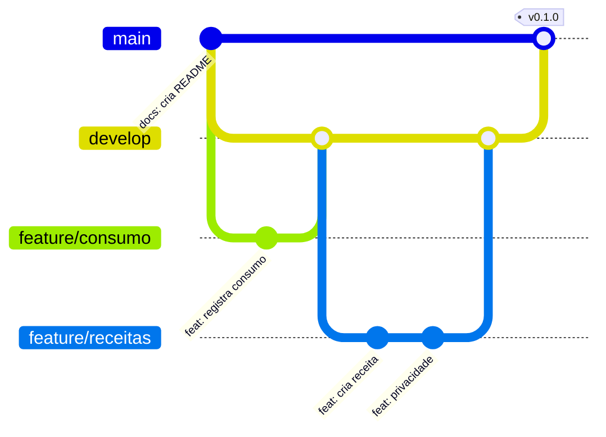

- `main`: versão estável, só recebe código revisado.
- `develop`: junta o que foi feito no ciclo.
- `feature/...` e `fix/...`: uma branch por tarefa ou correção, sempre criada a partir da `develop`.
- Tarefas viram **issues** em um quadro Kanban, e cada branch entra por **Pull Request** revisado por um colega. O **GitHub Actions** roda os testes antes do merge.
- No fim de cada ciclo, a `develop` vai para a `main` com uma **tag** de versão (`v0.1.0`, `v0.2.0`...).

**Commits**

Mensagens curtas, com um prefixo que diz o tipo da mudança:

```
feat(receitas): adiciona escolha de privacidade
fix(consumo): corrige soma ao remover um item
docs: atualiza diagrama de importação
test(importar): cobre receita já importada
chore: configura GitHub Actions
```

Usamos `feat` (novidade), `fix` (correção), `docs` (documentação), `test` (testes) e `chore` (configuração). Cada commit trata de uma coisa só, e senhas, arquivos `.env` e o APK ficam no `.gitignore`.

---

## 🎨 4. Projeto de Interface

As telas são capturas do protótipo em HTML. Todas têm **1080 × 2400 px** (proporção de um celular Android, 360 × 800 dp) e aparecem com a mesma largura.

<table>
<tr><td align="center">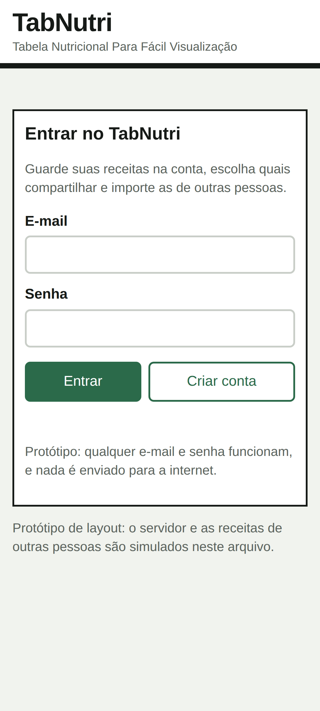<br><sub><b>1. Login</b></sub></td><td align="center">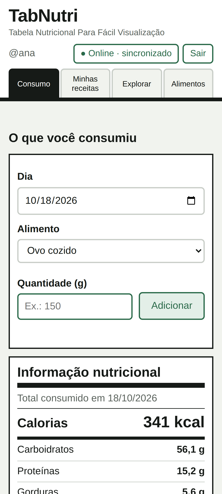<br><sub><b>2. Consumo</b></sub></td><td align="center">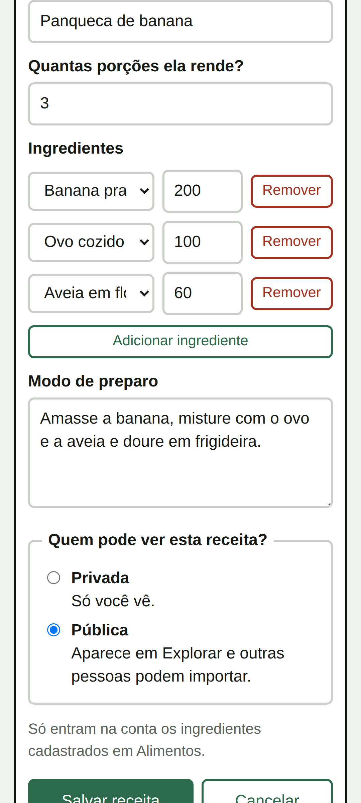<br><sub><b>3. Nova receita</b></sub></td><td align="center">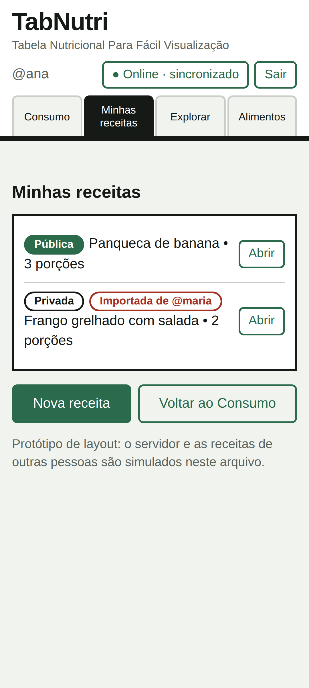<br><sub><b>4. Minhas receitas</b></sub></td><td align="center">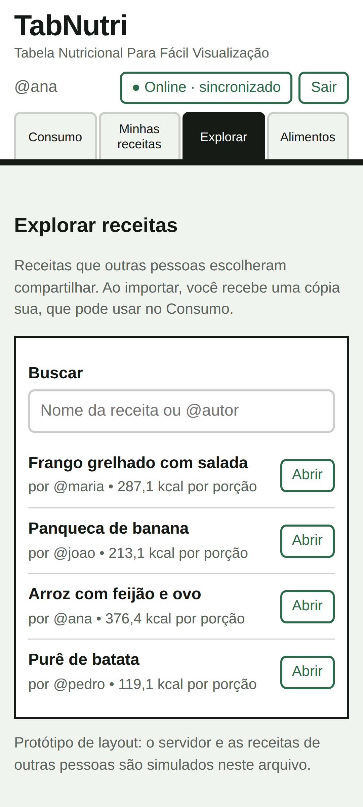<br><sub><b>5. Explorar</b></sub></td></tr>
<tr><td align="center">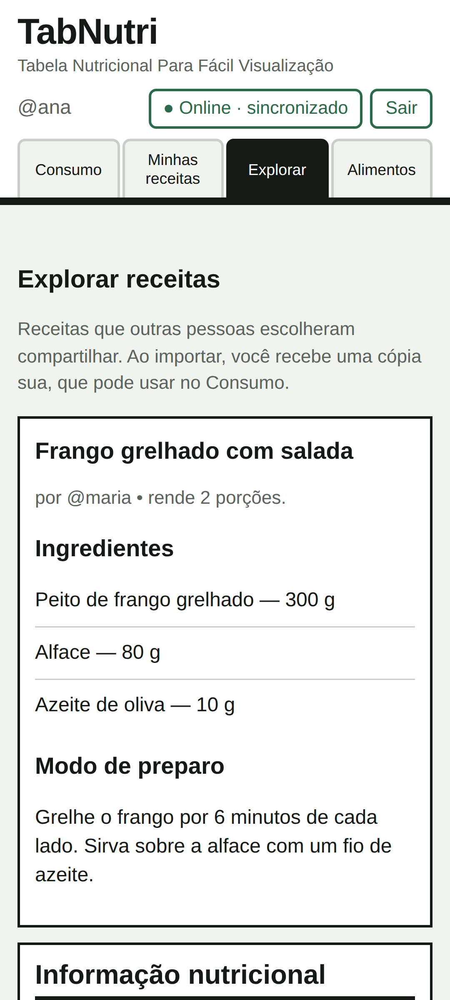<br><sub><b>6. Receita de outro usuário</b></sub></td><td align="center">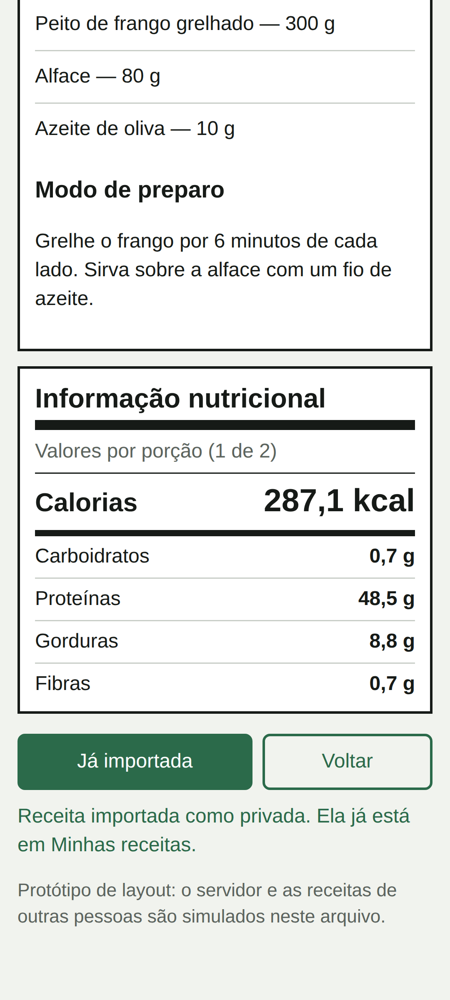<br><sub><b>7. Receita importada</b></sub></td><td align="center">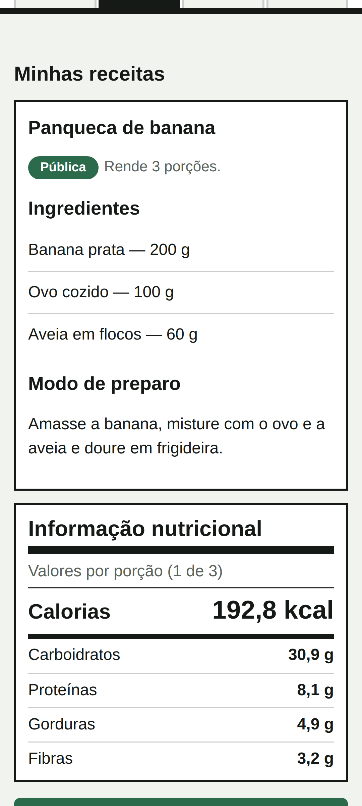<br><sub><b>8. Receita aberta</b></sub></td><td align="center">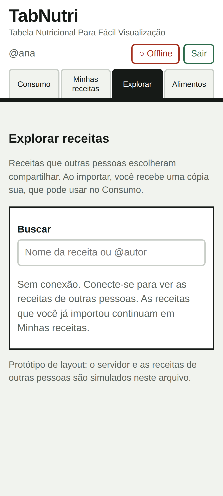<br><sub><b>9. Modo offline</b></sub></td><td align="center">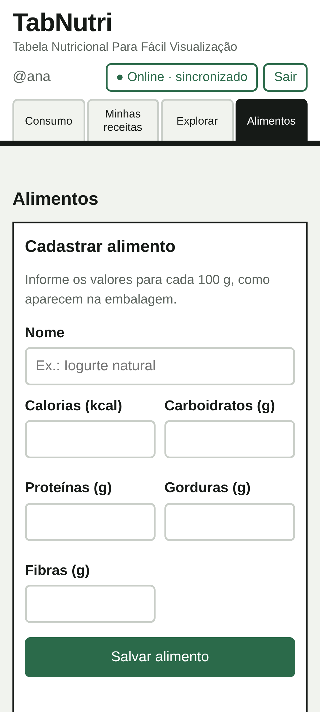<br><sub><b>10. Alimentos</b></sub></td></tr>
</table>

1. **Login:** entrada com e-mail e senha (no protótipo, qualquer dado funciona).
2. **Consumo:** escolha do dia, do alimento e da quantidade em gramas, com o rótulo nutricional do dia.
3. **Nova receita:** ingredientes, porções, modo de preparo e a opção **Privada** ou **Pública**.
4. **Minhas receitas:** lista com etiquetas Privada, Pública e Importada.
5. **Explorar:** receitas de outras pessoas, com busca por nome ou autor.
6. **Receita de outro usuário:** ingredientes, preparo e rótulo por porção antes de importar.
7. **Receita importada:** o botão vira "Já importada" e a cópia fica privada.
8. **Receita aberta:** permite adicionar 1 porção ao consumo, mudar a privacidade ou excluir.
9. **Modo offline:** Explorar pede internet, mas as receitas salvas continuam disponíveis.
10. **Alimentos:** cadastro de novos alimentos e tabela dos que já existem.

**Visual:** rótulo nutricional com bordas grossas, verde como cor principal, quatro abas no topo e um botão Online/Offline sempre visível. Os protótipos de alta fidelidade serão feitos no Figma.

---

## 📊 5. Diagramas

### Casos de uso

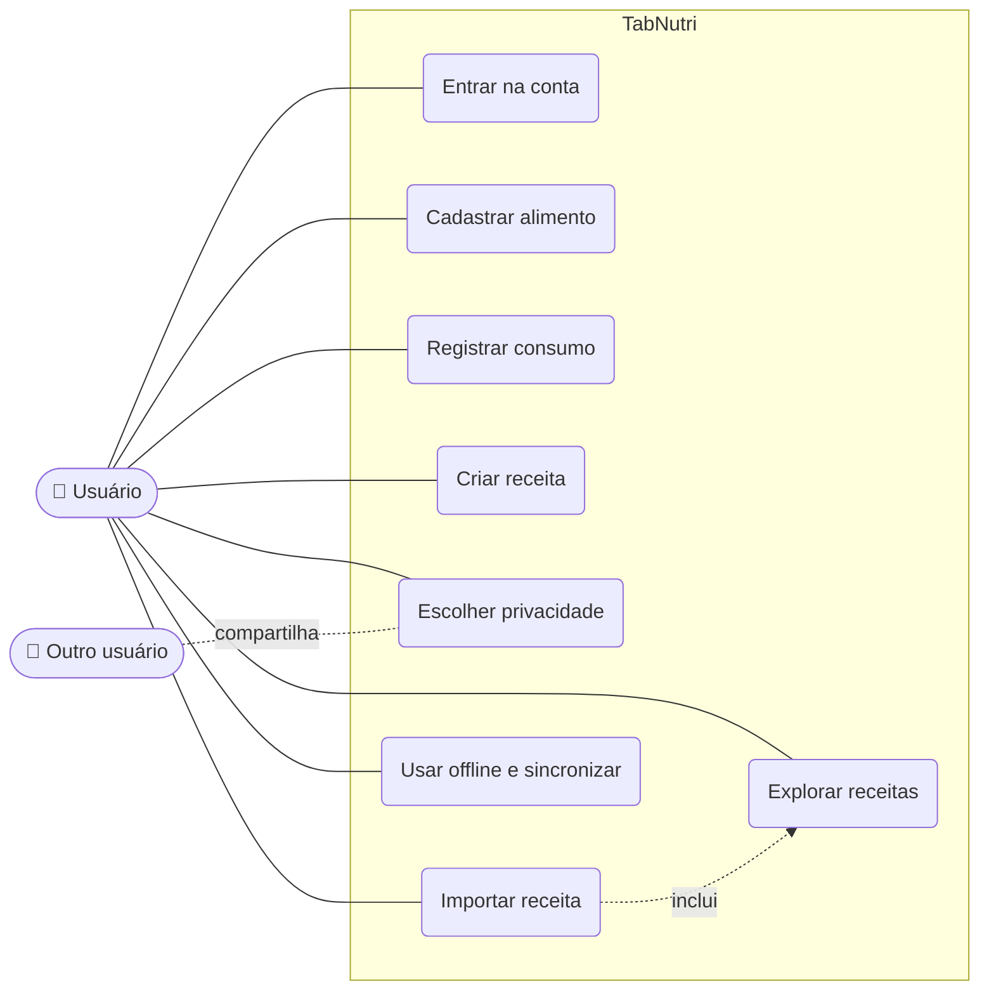

### Sequência: importar uma receita

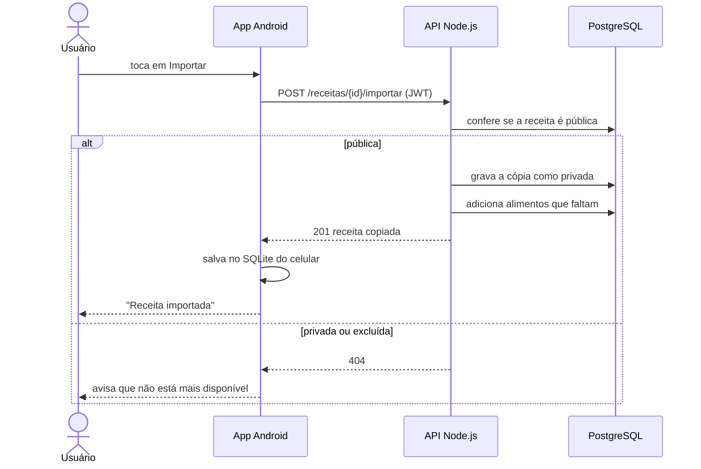

### Arquitetura

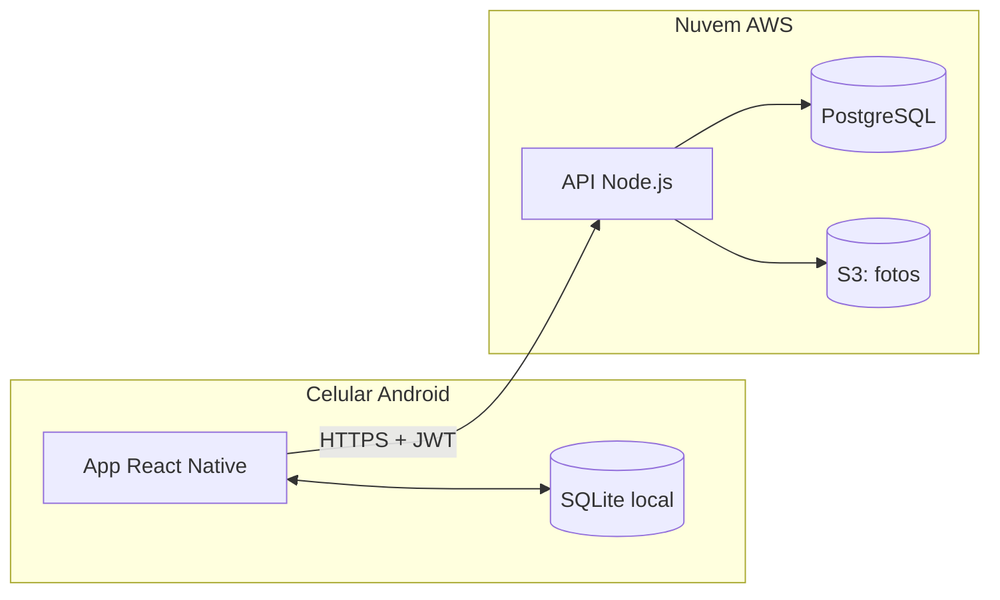

### Modelo de dados

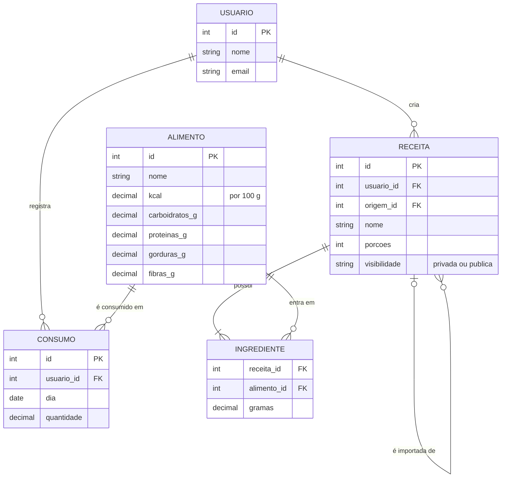

---

## ▶️ Como abrir o protótipo

1. Baixe o repositório (**Code → Download ZIP**) e extraia os arquivos.
2. Abra `prototipo/tabnutri.html` no navegador. No computador, estreite a janela para ver o layout de celular.
3. Entre com qualquer e-mail e senha.

## 👥 Equipe

| Nome |
|---|
| Marlon Oliveira Costa |

## 📄 Licença

Projeto acadêmico desenvolvido para a disciplina de Engenharia de Software 1 (Fatec).
