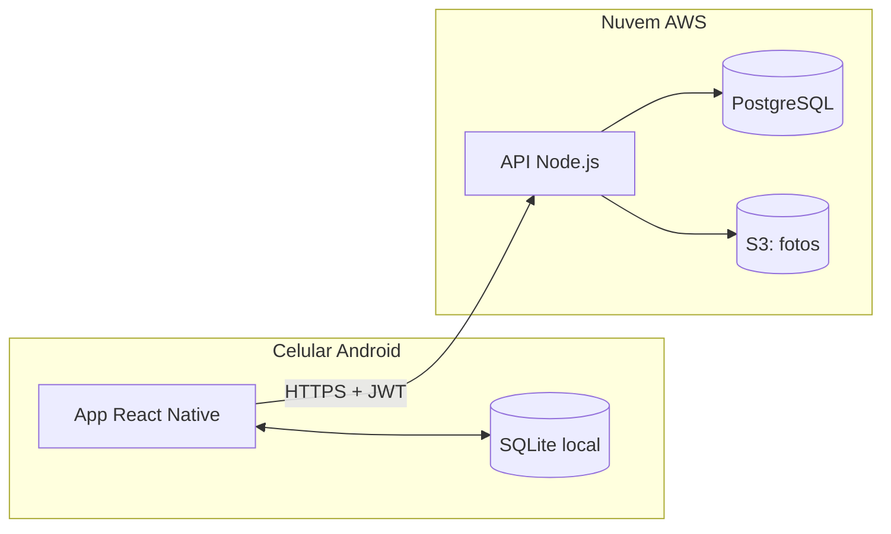

# Arquitetura

## Descrição resumida

| Componente | Onde fica | Descrição |
|---|---|---|
| App React Native | Celular Android | Aplicativo que o usuário usa: registra consumo, cria receitas, explora e importa receitas de outras pessoas. |
| SQLite local | Celular Android | Banco de dados dentro do celular. Guarda as receitas salvas e o consumo para o app funcionar offline. |
| API Node.js | Nuvem AWS (EC2) | Servidor que recebe os pedidos do app, confere o login, aplica as regras de privacidade e acessa o banco e as fotos. |
| PostgreSQL | Nuvem AWS (RDS) | Banco de dados principal. Guarda usuários, alimentos (base TACO), receitas, ingredientes e consumos. |
| S3: fotos | Nuvem AWS (S3) | Armazenamento das fotos das receitas. |

| Conexão | Descrição |
|---|---|
| App ↔ SQLite local | Troca de dados nos dois sentidos: o app lê e grava no celular, e usa esses dados quando está sem internet. |
| App → API (HTTPS + JWT) | O app envia pedidos pela internet, de forma criptografada (HTTPS), com o token JWT que prova quem é o usuário. |
| API → PostgreSQL | A API consulta e grava os dados principais no banco. |
| API → S3 | A API envia e busca as fotos das receitas. |

**Siglas:** `JWT` (*JSON Web Token*) é o token de autenticação enviado a cada pedido; `HTTPS` é o protocolo seguro de comunicação; `EC2`, `RDS` e `S3` são os serviços da AWS para servidor, banco de dados e arquivos.
