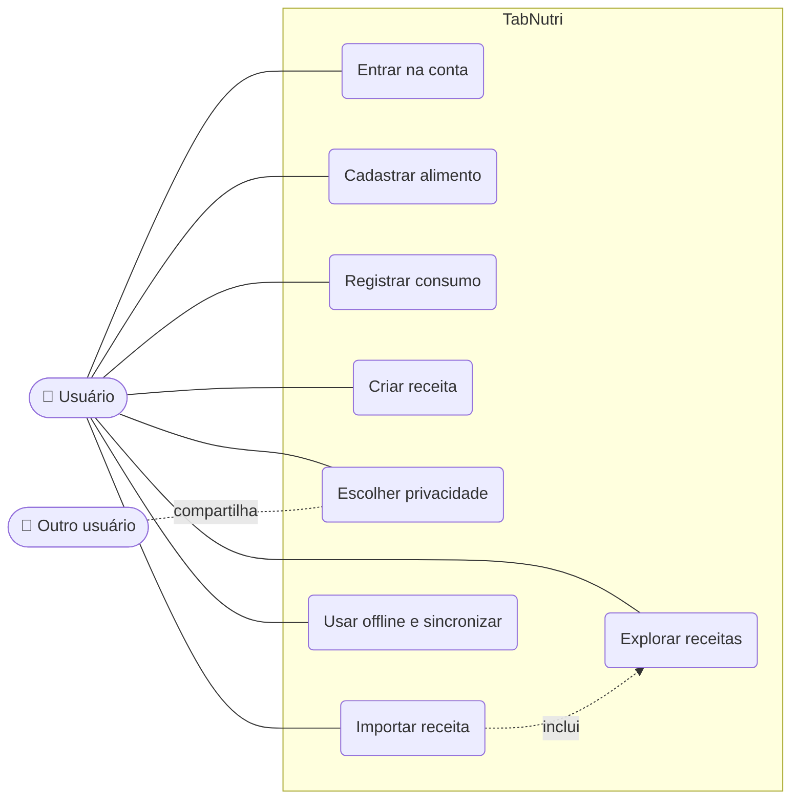

# Casos de uso

## Descrição resumida

| Ator | Descrição |
|---|---|
| Usuário | Pessoa que usa o TabNutri. Faz login, registra o que comeu, cria receitas e explora as receitas de outras pessoas. |
| Outro usuário | Qualquer outra pessoa do app. Participa ao compartilhar receitas públicas, que o usuário pode encontrar e importar. |

| Caso de uso | Ator | Descrição |
|---|---|---|
| Entrar na conta | Usuário | Faz cadastro e login com e-mail e senha. Sem login não acessa o app. |
| Cadastrar alimento | Usuário | Adiciona um novo alimento à base, informando calorias, carboidratos, proteínas, gorduras e fibras por 100 g. |
| Registrar consumo | Usuário | Informa o alimento e a quantidade em gramas e vê o rótulo nutricional do dia. |
| Criar receita | Usuário | Monta uma receita com ingredientes, porções e modo de preparo. O app calcula os nutrientes por porção. |
| Escolher privacidade | Usuário | Define se a receita é **privada** (só o dono vê) ou **pública** (aparece para outras pessoas). |
| Explorar receitas | Usuário | Busca receitas públicas de outras pessoas por nome ou autor e vê os detalhes antes de importar. |
| Importar receita | Usuário | Copia uma receita pública para a própria conta. A cópia é privada e pode ser editada sem alterar a original. |
| Usar offline e sincronizar | Usuário | Consulta as receitas salvas sem internet e envia as mudanças para o servidor quando a conexão volta. |

| Relação | Descrição |
|---|---|
| Usuário — casos de uso (linha contínua) | Indica que o usuário participa diretamente daquele caso de uso. |
| Outro usuário — Escolher privacidade (`compartilha`) | Quando uma receita é pública, o outro usuário passa a poder vê-la. Ele participa de forma indireta, por meio da receita compartilhada. |
| Importar receita — Explorar receitas (`inclui`) | Importar sempre depende de explorar: para importar, o usuário primeiro encontra a receita na aba Explorar. |

**Termos:** `inclui` (*include*) significa que um caso de uso sempre usa outro como parte do seu fluxo; a seta aponta para o caso de uso incluído. As linhas tracejadas indicam relações indiretas ou de dependência, e as contínuas indicam participação direta do ator.
