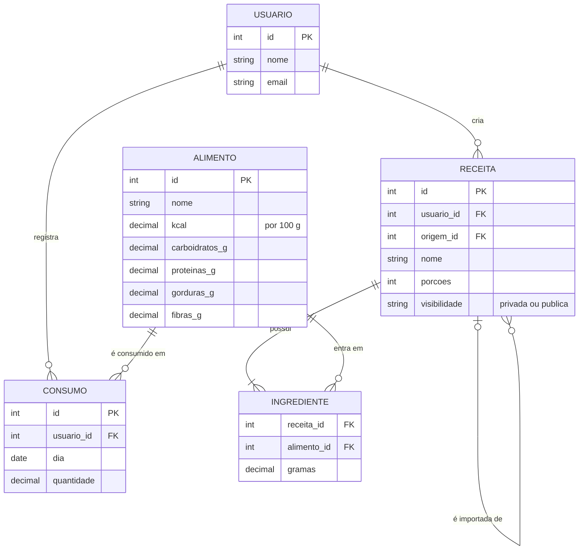

# Modelo de dados

## Descrição resumida

| Entidade | Dono / Relacionada a | Descrição |
|---|---|---|
| USUARIO | Todas as receitas e consumos | Pessoa que usa o app. Guarda nome e e-mail e identifica quem é dono de cada receita e de cada registro de consumo. |
| ALIMENTO | Ingredientes e consumos | Base de alimentos (como a TACO). Guarda calorias, carboidratos, proteínas, gorduras e fibras por 100 g. |
| RECEITA | Usuário (dono) | Receita cadastrada com nome, número de porções e visibilidade (privada ou pública). Quando é importada, guarda a receita de origem. |
| INGREDIENTE | Receita e alimento | Liga uma receita a um alimento e informa quantos gramas dele entram na receita. |
| CONSUMO | Usuário e alimento | Registra o que o usuário comeu em um dia e a quantidade em gramas. |

| Relacionamento | Descrição |
|---|---|
| Usuário cria receita | Um usuário pode criar várias receitas; cada receita tem um único dono. |
| Usuário registra consumo | Um usuário pode registrar vários consumos; cada consumo pertence a um único usuário. |
| Receita possui ingredientes | Toda receita tem pelo menos um ingrediente. |
| Alimento entra em ingredientes | Um mesmo alimento pode ser usado em vários ingredientes de receitas diferentes. |
| Alimento é consumido em consumos | Um mesmo alimento pode aparecer em vários registros de consumo. |
| Receita é importada de receita | Uma receita pode ser cópia de uma original, e a original pode ter várias cópias importadas. |

**Siglas:** `PK` (chave primária) identifica cada registro; `FK` (chave estrangeira) aponta para o `id` de outra tabela.
