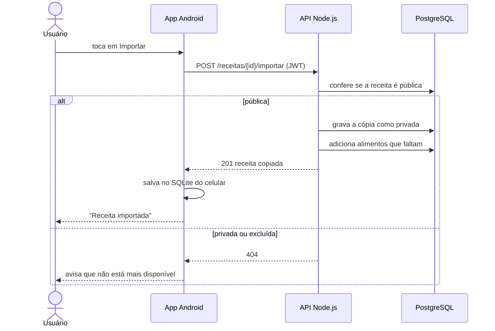

# Sequência: importar uma receita

## Descrição resumida

| Participante | Descrição |
|---|---|
| Usuário | Pessoa que usa o app e inicia a importação. |
| App Android | Aplicativo no celular: envia o pedido, mostra mensagens ao usuário e salva a receita importada no SQLite local. |
| API Node.js | Servidor que recebe o pedido, valida o token e decide se a importação é permitida. |
| PostgreSQL | Banco principal: guarda as receitas e informa se cada uma é pública ou privada. |

| Passo | Quem faz | Descrição |
|---|---|---|
| 1. Tocar em Importar | Usuário → App | O usuário escolhe uma receita na aba Explorar e toca no botão Importar. |
| 2. Enviar o pedido | App → API | O app envia `POST /receitas/{id}/importar` com o token JWT, que identifica quem está importando. |
| 3. Conferir a visibilidade | API → BD | A API consulta o banco para saber se a receita é pública. |

| Cenário | Passo | Descrição |
|---|---|---|
| **Receita pública** | Gravar a cópia | A API grava no banco uma cópia da receita como **privada**, pertencente ao usuário que importou. |
| | Adicionar alimentos | A API adiciona ao cadastro do usuário os alimentos usados na receita que ainda não existem lá. |
| | Responder `201` | A API avisa o app que a receita foi copiada com sucesso. |
| | Salvar no celular | O app guarda a cópia no SQLite local, para ela ficar disponível offline. |
| | Confirmar | O app mostra "Receita importada" ao usuário. |
| **Receita privada ou excluída** | Responder `404` | A API responde que a receita não foi encontrada, sem revelar se ela existe. |
| | Avisar o usuário | O app informa que a receita não está mais disponível. |

**Siglas e termos:** `JWT` (*JSON Web Token*) é o token de autenticação; `201` é o código HTTP de "criado com sucesso"; `404` é o código HTTP de "não encontrado"; `alt` / `else` no diagrama separam os dois caminhos possíveis (receita pública ou não).
